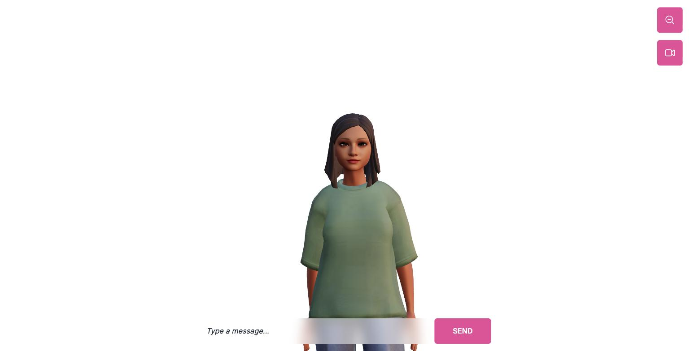

# Virtual Avatar

A browser-based 3D avatar that speaks: pre-rendered audio drives viseme
blendshapes on a rigged head so the mouth matches the words, with facial
expressions and body animation layered on top. Built with Next.js App Router
and React Three Fiber.



```bash
pnpm install && pnpm dev   # http://localhost:3000
```

## Provenance

This started as a port of Wawa Sensei's
[r3f-virtual-girlfriend-frontend](https://github.com/wass08/r3f-virtual-girlfriend-frontend),
a Vite + JavaScript tutorial project. The 3D assets, the Preston Blair viseme
mapping, and the shape of the expression system come from there.

What was built on top of it:

- Ported to **Next.js App Router** — route handlers and a server action in
  place of a separate Express backend.
- Converted to **TypeScript**, including a typed `GLTFResult` for the
  generated avatar mesh so the node and material lookups are checked.
- Upgraded to **Next 15 / React 19 / R3F 9 / three 0.184** from the original
  React 18 / R3F 8 generation.
- Fixed the animation system, which was inert in the original port (see
  below), and extracted the viseme lookup into a tested pure function.
- Removed the dependencies responsible for 30 security advisories and got
  `pnpm audit` to zero.

I'd rather show the port and the repair work honestly than present the
tutorial's scene graph as my own design.

## How it works

### The scene

`app/page.tsx` mounts a single R3F `<Canvas>`. Everything below it is scene
graph, not DOM:

```
<Canvas>
  └── <Experience>
        ├── <CameraControls>     camera rig, driven by the zoom toggle
        ├── <Environment>        image-based lighting ("sunset" preset)
        ├── <Dots>               troika-text typing indicator
        ├── <Avatar>             the rigged character
        └── <ContactShadows>     grounding shadow
```

The chat UI (`components/UI.tsx`) is ordinary DOM layered over the canvas with
`pointer-events` gating, so text input never fights the camera controls for
mouse events.

### Lipsync

This is the part worth reading. Each message carries an audio clip and a
transcript of **mouth cues** — a time-ordered list of spans:

```json
{ "mouthCues": [
    { "start": 0.00, "end": 0.32, "value": "A" },
    { "start": 0.32, "end": 0.51, "value": "D" }
] }
```

`value` is a [Preston Blair](https://en.wikipedia.org/wiki/Preston_Blair)
mouth shape (`A`–`H`, plus `X` for rest), the output format of
[Rhubarb Lip Sync](https://github.com/DanielSWolf/rhubarb-lip-sync).
`constants/corresponding.ts` maps those letters onto the ARKit-style viseme
blendshapes the Ready Player Me mesh actually exposes (`viseme_PP`,
`viseme_AA`, …).

Every frame, `useFrame` reads `audio.currentTime` and asks
[`visemeAt()`](src/lib/lipsync.ts) which cue covers that instant. The audio
element is the clock — not a timer or a frame counter — so the mouth cannot
drift from the sound even if the render loop stutters. The matched viseme
lerps toward 1 and every other viseme relaxes toward 0, which is what keeps
the transitions from snapping.

`visemeAt` is the only meaningful non-UI logic here, so it is the only thing
with tests (`pnpm test`). The cases that matter are the boundaries: cue
bounds are inclusive and the earlier cue wins where two touch, because
switching to exclusive bounds silently drops a frame at every transition and
reads as "the lipsync feels off".

### Expressions and animation

Two independent layers ride on the same mesh:

- **Facial expressions** (`constants/facialExpressions.ts`) are named sets of
  blendshape weights — `smile` is a specific blend of `browInnerUp`,
  `eyeSquint*`, `mouthPress*`. Applied per-frame with the same lerp, so
  expression changes ease rather than pop.
- **Body animation** comes from Mixamo clips in `animations.glb`, played
  through three's `AnimationMixer` with a 0.5s cross-fade between clips.
- **Blinking** runs on its own randomised 1–5s timer, independent of both, so
  the character still looks alive while idle.

Because these all write to `morphTargetInfluences` on the same meshes, they
have to agree on who owns what. The expression pass explicitly skips
`eyeBlinkLeft` / `eyeBlinkRight` and the blink pass drives them alone —
otherwise an expression holding those weights at 0 every frame would fight
the blink and the eyes would never close.

Visit `/edit` for a [leva](https://github.com/pmndrs/leva) panel that exposes
every morph target individually — the tool used to author the expression
presets above. "Setup mode" freezes the automatic passes so you can dial in
weights by hand and dump them to the console.

## Running it

Requires Node 20+ and pnpm.

```bash
pnpm install
pnpm dev
```

The avatar demo works with no configuration — it plays pre-rendered audio and
viseme transcripts committed under `public/audios/`.

### Environment variables

Copy `.env.example` to `.env.local`:

| Variable | Required | Purpose |
| --- | --- | --- |
| `ELEVEN_LABS_API_KEY` | No | Lets `GET /api/voices` list the voices on your ElevenLabs account. Without it that route returns 503; nothing else is affected. |

### Scripts

| Command | Does |
| --- | --- |
| `pnpm dev` | Dev server |
| `pnpm build` | Production build |
| `pnpm lint` | ESLint |
| `pnpm typecheck` | `tsc --noEmit` |
| `pnpm test` | Viseme mapping tests |

CI runs all of these plus `pnpm audit` on every push and PR.

## Known limitations

Being straight about what this is:

- **The conversation is canned.** `/api/chat` returns a fixed two-message
  script with pre-rendered audio. The live LLM + TTS + Rhubarb pipeline the
  architecture is shaped for is not wired up — `getIntroMessages()` in
  `src/lib/messages.ts` is the seam where it would go.
- **The ElevenLabs integration is only voice listing.** Generating speech at
  runtime would mean adding TTS synthesis and running Rhubarb over the result
  to produce the cues.
- **`@typescript-eslint/parser` is pinned to 6.x** by `eslint-config-next`,
  which drags in a `minimatch` that needs a pnpm override. Worth revisiting
  when Next's ESLint config moves on.

## Credits

- Original project: [Wawa Sensei](https://github.com/wass08) —
  r3f-virtual-girlfriend-frontend
- Avatar mesh: [Ready Player Me](https://readyplayer.me/)
- Body animations: [Mixamo](https://www.mixamo.com/)
- Viseme transcripts: [Rhubarb Lip Sync](https://github.com/DanielSWolf/rhubarb-lip-sync)

## License

MIT — see [LICENSE](LICENSE). Covers the code; the third-party assets above
carry their own terms.
